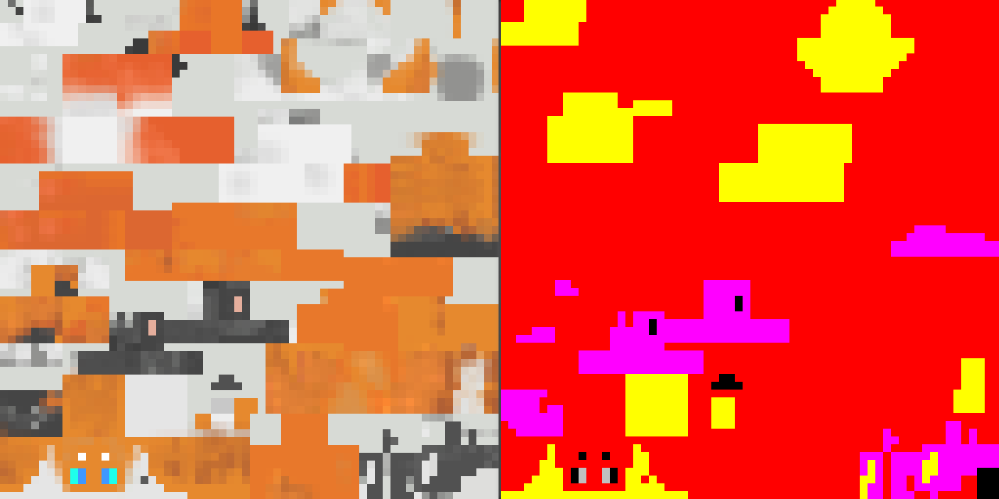

# Adding Color Customization to Custom Forms

To enable in-game color customization (and the visual Form Color Menu) for your custom form, create `colormask` textures and register them in your model config JSON under `assets/<namespace>/ssc_form_model/`.

## 1. Creating a Colormask Texture



Draw the `colormask` texture based on your form's texture, using RGBA channels to mark each customizable color region:

| Channel | R | G | B | A (value = 0) | A (value = 1) |
| :---: | :---: | :---: | :---: | :---: | :---: |
| Region | Primary Color | Accent Color 1 | Accent Color 2 | Eye Color 1 | Eye Color 2 |

- Color override priority: **Primary Color → Accent Color 1 → Accent Color 2 → Eye Color** (later channels overwrite earlier ones).
- The mod automatically blends the original texture's grayscale shading when generating colored textures, so your `colormask` only needs flat solid channel fills.

## 2. Registering in the Model Config JSON

In `assets/<namespace>/ssc_form_model/origins.origin.<namespace>.<origin_name>.json`, add the corresponding `*_mask` fields for any texture layers you use:

- `texture` → `texture_mask` (base texture mask)
- `overlay` → `overlay_mask` (overlay texture mask)
- `fullbright_texture` → `fullbright_texture_mask` (emissive texture mask)
- `emissive_overlay` → `emissive_overlay_mask` (pulsing full-body emissive overlay mask)

Example:

```json
{
  "load_priority": 0,
  "name": "example_namespace.form_example.model_name",
  "layer": "origins:origin",
  "form": "example_namespace:form_example",
  "wide_only": true,

  "model": "example_namespace:geo/form_example.geo.json",
  "texture": "example_namespace:textures/form_example.png",
  "texture_mask": "example_namespace:textures/form_example_colormask.png",
  "fullbright_texture": "example_namespace:textures/form_example_emission.png",
  "fullbright_texture_mask": "example_namespace:textures/form_example_emission_colormask.png",
  "hidden": [
    "leftLeg", "rightLeg", "rightPants", "leftPants",
    "body", "jacket"
  ],

  "animation_system": "shape-shifter-curse:default",
  "animation_system_config": {
    "tail": {
      "chain": {
        "tail": [0, 1, 2, 3]
      }
    }
  }
}
```

Reload resource packs in-game and your custom form will support live recoloring in the Form Color Menu.
