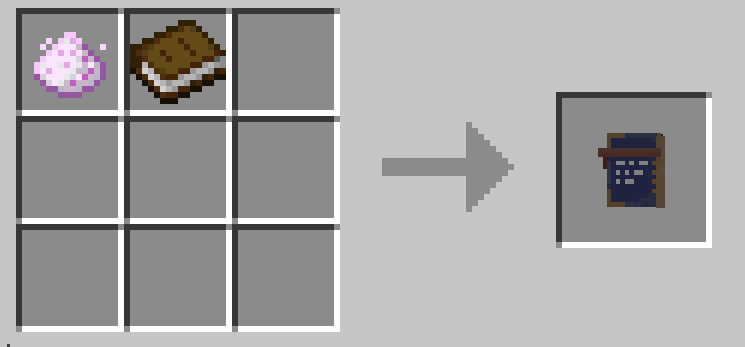

# Overview

After installing the mod and entering the game for the first time, you will receive a usable item called the `Book of Shape Shifter`.

Right-click to use it and select `Open Book of Shape Shifter` to enable the mod's content.

Throughout your gameplay, the `Book of Shape Shifter` serves as an essential tool for reviewing your current form's introduction, advantages and disadvantages, as well as instinct system information.

### Lost the Book of Shape Shifter?



You can craft a new one at any time using `Untreated Moondust` + `Book`.

`Untreated Moondust` can be obtained during the `Cursed Moon Event` or crafted directly. See `Mod Specific Items` and `Form Change And Recovery` for details.

---

## Custom Starting Form (Servers / Modpacks)

Starting from version 1.10.0, server administrators and modpack authors can configure an initial form granted automatically when new players join a world—allowing you to skip the traditional "open the Book of Shape Shifter" step or start players in a specific/random form.

To enable this feature:

1. Set `enableInitialForm = true` in `config/shape-shifter-curse-common.toml` (or via Mod Menu).
2. Ensure the world gamerule `sscUseInitialForm` is `true` (enabled by default; toggleable via `/gamerule sscUseInitialForm true|false`).
3. List one or more candidate forms in `initialFormIds` using the format `namespace:form_id:weight` (datapack custom forms are supported). New players will be assigned one randomly by weight:

```toml
enableInitialForm = true
initialFormIds = [
    "shape-shifter-curse:original_before_enable:1",
    "shape-shifter-curse:bat_0:2",
    "shape-shifter-curse:ocelot_0:1"
]
```

!!! note

    - Custom initial forms **only apply to new players who have not yet chosen a form** and will not overwrite existing players' forms.
    - Setting `immediatelyTransform = true` in the common config skips the transformation transition animation for instant transformations.
    - If you want transformative potions or witches to affect players who have not opened the Book of Shape Shifter yet, enable `statusPotionWithCurse` and `witchPotionForPreBook` in the common config.
