# Form-Specific Tools and Trinkets

After version 1.8.1, the mod adds various form-specific tools and trinkets. They can significantly enhance or alter the abilities of the current form, thereby enriching the gameplay experience.

Trinkets are compatible with the `Trinkets`, `Curios`, and `Accessories` mods.

!!! note

    Starting from version 1.10.0, **the 13 base form trinkets have moved from the Crafting Table to the `Shape Shifter Altar`** (ingredients and patterns remain the same, requiring a small amount of moondust fuel).

    In addition, 12 **`+` upgraded trinkets/tools** have been added: combine the base item with its corresponding `Catalyst Core` (not consumed) and 16 `Untreated Moondust` at the `Shape Shifter Altar` to upgrade. See `Shape Shifter Altar & Catalyst Cores` for details.

    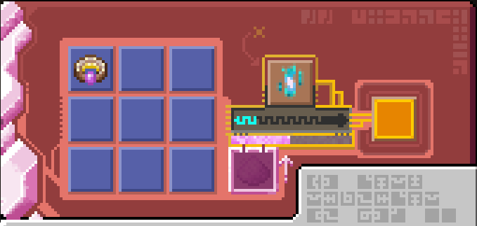

## Moondust Crystal Grit and Moondust Crystal

To craft these exclusive tools and trinkets, the advanced material `Moondust Crystal` is indispensable.

You can craft `Moondust Crystal Grit` from `Untreated Moondust`, `Nether Quartz`, and a `Ghast Tear`, then smelt it in a furnace or blast furnace; starting from 1.10.0, `Moondust Crystal` can also be crafted directly at the `Shape Shifter Altar`.

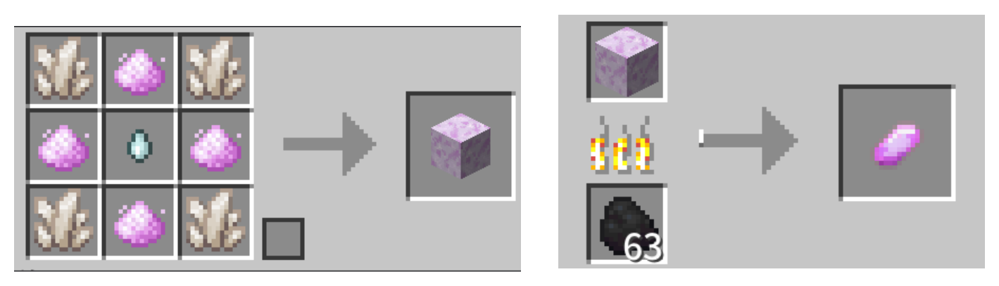

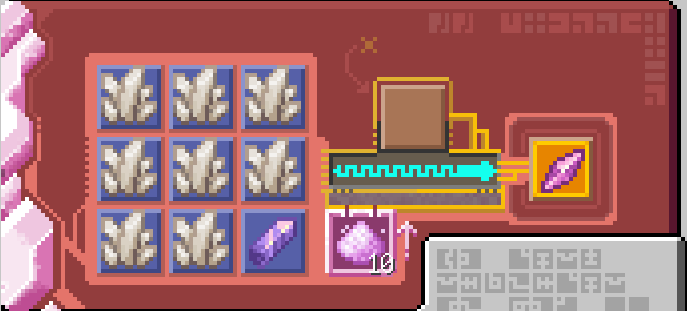

## Crafting Methods and Effects

### Bat Form

* Charm of Night Crystal:

    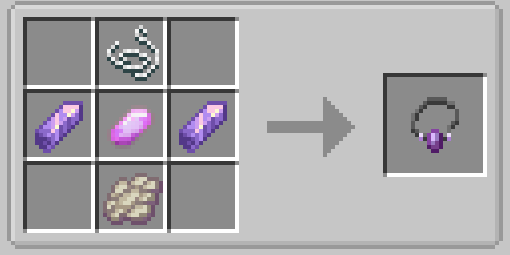

  You no longer lose maximum health under sunlight.

  **Charm of Night Crystal+ (Night Catalyst Core)**: Grants extra Resistance in darkness.

* Charm of Hollow Fang:

    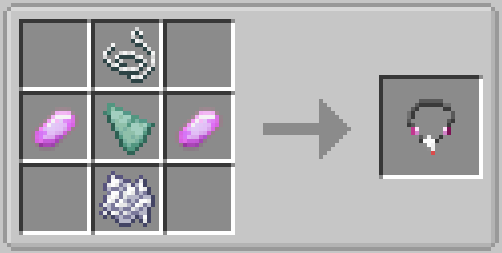

  Your attacks can drain health and hunger, but you can no longer recover from food.

  **Charm of Hollow Fang+ (Night Catalyst Core)**: Melee attacks also inflict Poison.

* Attach Hook:

    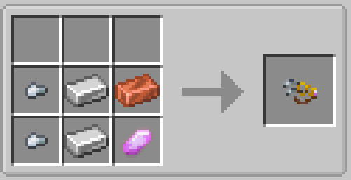

  Weapons and tools no longer slip out of your hands, but their durability consumption increases.

  **Attach Hook+ (Night Catalyst Core)**: Mining blocks grants Haste.

* Diamond Mining Claw:

    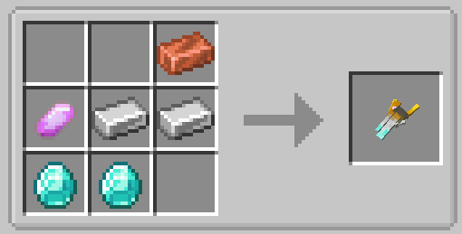

  [Tool] Requires strong foreclaws to use. Increases mining efficiency and damage, and your wall-clinging ability is not affected while wielding this tool. Starting from 1.10.0, it counts as a multi-tool covering pickaxe, axe, shovel, and hoe blocks.

### Avali (Bat Sub-Form)

Avali can equip Bat Form trinkets. Additionally, unlocking the `Tool Modification` perks in its Perk Tree lets you craft exclusive weapons in your inventory:

* **Graphene Blade**: Right-click a `Golden Sword` with a `Block of Coal` in your inventory. A low-durability, high-damage melee blade.
* **Compound Kinetic Bow**: Right-click a `Bow` with a `Diamond` in your inventory. High durability with increased base arrow damage.

### Ocelot Form

* Collar of Tension:

    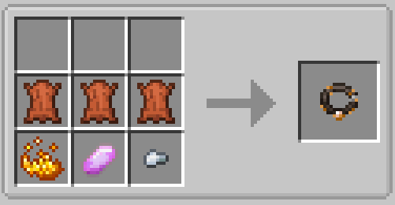

  For true hunters only. Your swipes and pounces deal increased damage, but you can no longer automatically dodge projectiles.

* Collar of Whiskers:

    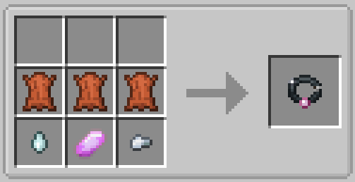

  For true hunters only. When your dodge ability triggers, you gain a temporary regeneration effect.

  **Collar of Whiskers+ (Jungle Catalyst Core)**: Successful dodges also grant Strength.

* Digestion Fiber Ball:

    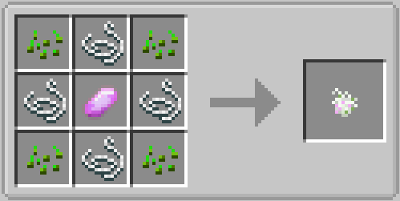

  Allows you to digest cooked meat and vegetarian food, although their restoration efficiency remains relatively low.

  **Digestion Fiber Ball+ (Jungle Catalyst Core)**: Eating raw meat grants long-lasting Absorption.

### Snow Fox Form

* Charm of Reverse Thermometer:

    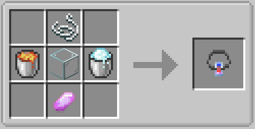

  Reverses the effects of cold and hot biomes on your maximum health.

  **Charm of Reverse Thermometer+ (Frost Catalyst Core)**: Grants Speed in hot environments.

* Frost Pawglove:

    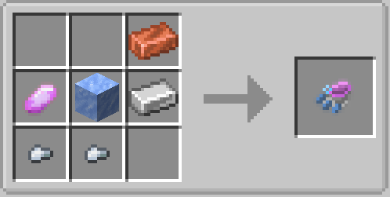

  Requires powerful ice magic to take effect. Your thrown snowballs inflict slowness in an area around the hit target, but deal reduced damage.

  **Frost Pawglove+ (Frost Catalyst Core)**: Further strengthens the area Slowness effect.

* Bottled Snowfall:

    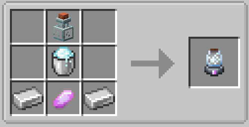

  [Tool] Requires powerful ice magic to use. Condense and fire snowballs at the cost of some hunger.

  **Bottled Snowfall+ (Frost Catalyst Core + End Crystal)**: Firing snowballs no longer consumes hunger.

### Familiar Fox Form

* Amulet Bracelet:

    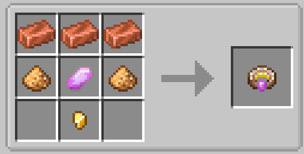

  You are no longer forcibly affected by witches and evokers, and you no longer suffer side effects when draining magic from hostile mobs.

  **Amulet Bracelet+ (Foxfire Catalyst Core)**: Greatly increases mana drained from hostile mobs.

### Axolotl Form

* Fountain Belt:

    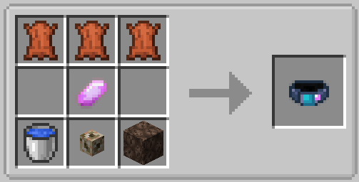

  Requires powerful water-current abilities to take effect. Water Burst no longer deals damage, but instead launches you and nearby entities into the air.

  **Fountain Belt+ (Surge Catalyst Core)**: Also grants Slow Falling upon activation.

### Jackal Form

* Withered Bandage:

    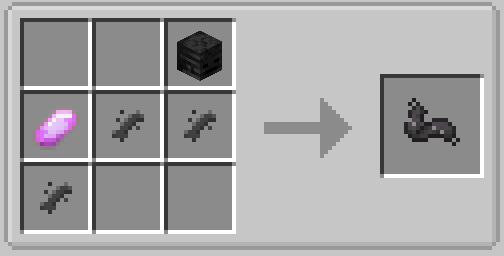

  The Wither effect you gain when hit has a reduced level, but lasts longer.

  **Withered Bandage+ (Dune Catalyst Core)**: Greatly extends the self-Wither duration when hit, providing a much longer empowered attack window.

### Spider Form

* Venom Spindle:

  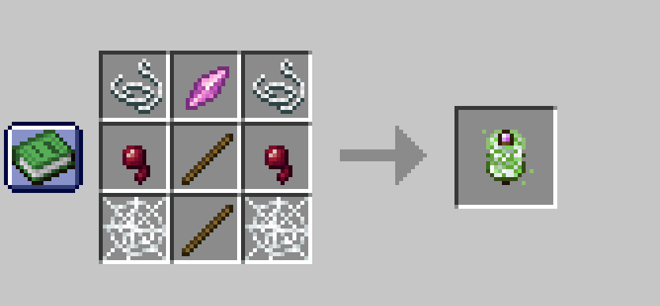

  Web projectiles deal damage on hit and replace their slow and entangle effects with poison.

  **Venom Spindle+ (Web Catalyst Core)**: Web projectiles deal damage and inflict Poison, Weakness, and Entangled simultaneously.

* Auxiliary Axe:

  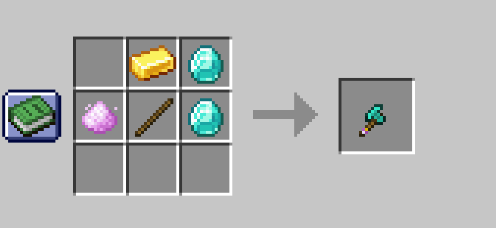

  Increases melee damage when equipped on extra hands, but slows attack speed.

* Auxiliary Sword:

  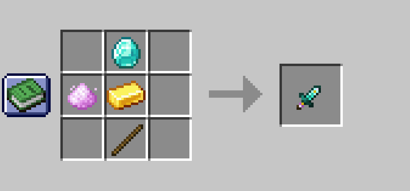

  Increases melee attack speed when equipped on extra hands, but consumes more durability each attack.

* Auxiliary Pickaxe:

  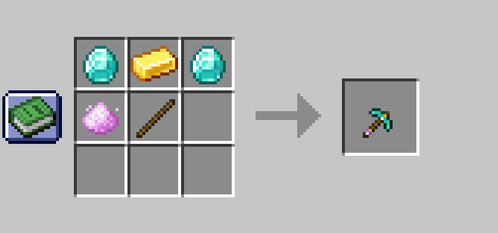

  Increases digging efficiency when equipped on extra hands, but reduces melee damage.

* Web Bullet:

  After unlocking the corresponding Perk in Spider Form's Perk Tree, right-click a `Cobweb` with another `Cobweb` in your inventory to craft throwable Web Bullets.

### Allay Form

* Resonant Core:

    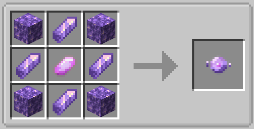

  Consuming Amethyst Shards grants regeneration to nearby entities, but no longer restores saturation.
