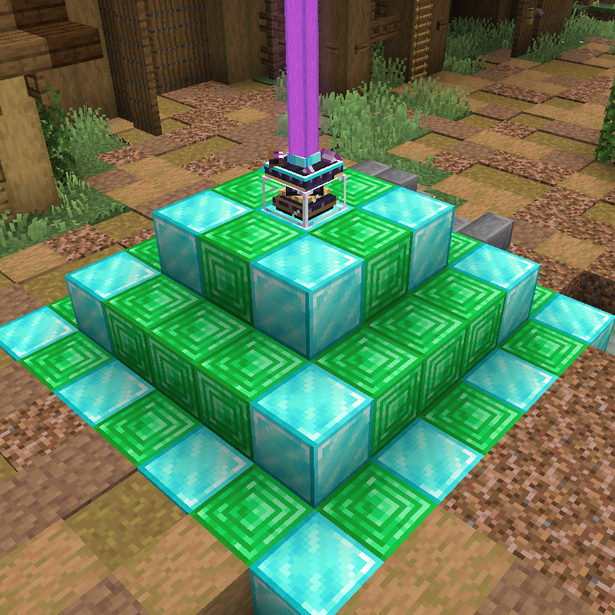
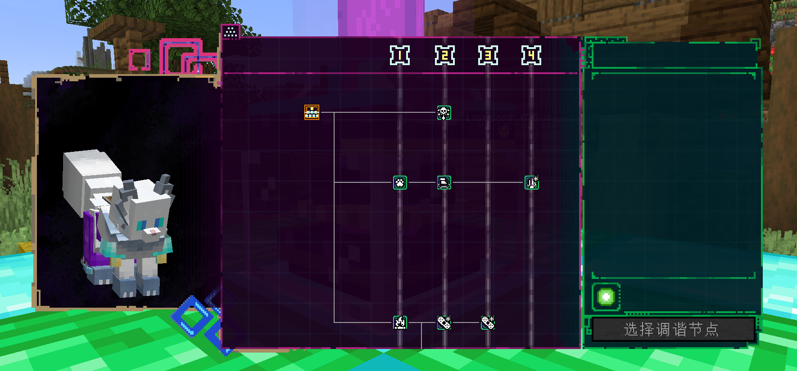

# Form Attuning & Perk Trees

Starting from version 1.10.0, all forms with a `Permanent Phase` as well as `Sub-Forms` feature their own dedicated `Perk Tree`, allowing you to unlock further potential, mitigate inherent weaknesses, and gain new active or passive abilities.

## Form Tuner Beacon

To unlock Perk nodes, first craft a `Form Tuner Beacon` at the `Shape Shifter Altar` using a vanilla `Beacon` and a `Shape Shifter Altar`.

The `Form Tuner Beacon` works just like a vanilla beacon: place it atop a pyramid of beacon base blocks (Iron, Gold, Emerald, Diamond, or Netherite blocks) in the Overworld. The number of pyramid layers (1–4) determines the tuner's tier, which dictates how high up the Perk Tree you can unlock.

!!! note

    The `Form Tuner Beacon` only functions in the Overworld. Like a vanilla beacon, you can place stained glass above it to tint its beam.

## Unlocking Perk Nodes

While in a Permanent Form or Sub-Form, right-click the `Form Tuner Beacon` to open the Form Attuning interface.

- Nodes progress horizontally by tier. Unlocking a node requires its prerequisite nodes to be unlocked and the beacon pyramid to meet the node's tier requirement.
- Unlocking nodes costs **experience points** (deducted directly as XP points, not full levels) or **`Glint Prisms`**.
- If you want to preview your form's Perk Tree anywhere, you can bind the `Open Skill Tree` key in Controls; actually unlocking nodes still requires using a `Form Tuner Beacon`.

## Active Power Keybinds

!!! note

    Version 1.10.0 adds `Active Power (1)` through `Active Power (6)` along with power-switching keybinds. **All of these keys are unbound by default.** Before using form active abilities, please go to `Controls → Key Binds` and assign keys to them.

- Some existing form actions have been unified under these keys (for example, Axolotl's Water Explosion is triggered by `Active Power (1)`, and Ocelot's Toggle Clip at Ledge is bound to `Active Power (6)`).
- If you prefer fewer separate keybinds, you can use `Previous/Next Power Binding` or `Enable Mouse Wheel Power Switching (Hold)` together with `Activate Selected Power Binding` to cycle and trigger abilities.

## Perk Tree Overview

To avoid spoilers, below is only a brief overview of each of the 9 Perk Trees—check the in-game attuning interface for specific node details:

- **Bat Form**: Improves ground posture and sunlight tolerance while unlocking aerial tools like Echolocation, arrow throwing, and Wingbeat.
- **Axolotl Form**: Improves moisture retention and land survivability, and enhances water propulsion, wave-striding efficiency, and tidal pull abilities.
- **Ocelot Form**: Strengthens armor adaptation, rapid metabolism, and ambush tactics to emphasize burst hunting.
- **Familiar Fox Form**: Expands mana capacity, siphoning, and defensive reflection, and unlocks craftable `Potion Charms` for ranged magical attacks.
- **Snow Fox Form**: Eases fire and heat vulnerability while enhancing mid-air mobility, cold recovery, and aggressive frost dives.
- **Anubis Wolf Form**: Enhances wolf spirit summoning and pack synergy, improves wither tolerance, and unlocks pack command ultimates.
- **Spider Form**: Improves land mobility and liquid-meal digestion, enhances silk secretion and web-bridging efficiency, and unlocks throwable `Web Bullets`.
- **Avali (Sub-Form)**: Provides nano-coating defense, wet/heat environmental adaptation, and the ability to modify weapons into `Graphene Blade` and `Compound Kinetic Bow`.
- **Marbled Polecat (Sub-Form)**: Focuses on multi-jump agility, momentum control, leaping dashes, hunter metabolism, and keen scent for a high-mobility melee style.
