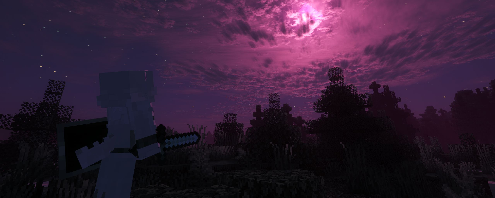

Various items and events in the world can affect your current form.

# Cursed Moon Event

The `Cursed Moon Event` may periodically trigger during nighttime hours. This is a global event affecting all players.

For versions 1.0.6 and above, the Cursed Moon event has been set to trigger at fixed lunar phases. The trigger interval is between 2–3 days (the previous triggering method had way too many bugs!).

The `Cursed Moon Event` lasts throughout the entire night, and sleeping is disabled by default during this time. It causes the following effects:

- Mobs drop `Untreated Moondust`.

- When in the default post-book form, your form will randomly change to `Phase Initial` of a `Progressive Form`, reverting when the event ends.

- When in `Phase Initial` or `Phase 1` of a `Progressive Form`, your form will temporarily advance one stage, reverting when the event ends.

- When in `Phase 2` of a `Progressive Form`, your form will temporarily revert to `Phase Initial` of that form, reverting when the event ends. This also provides an opportunity to use an `Inhibitor` or `Golden Apple` to recover.

- If your form changes during the Cursed Moon via an `Inhibitor`, `Golden Apple`, or command, moonset will no longer force you back into your previous form.

- Note: For some forms with special progression conditions, such as Spider Form, the effects of the `Cursed Moon Event` may differ slightly. Please refer to the corresponding form documentation.

- Servers can also disable forced transformations during the Cursed Moon via the `enableCursedMoonTransform` config option.

# Form Rollback & Recovery

- **Golden Apple**: Reduces `Instinct Value` and cures `Transformation Status Effects`. Starting from 1.10.0, eating a `Golden Apple` in `Phase Initial` reverts you directly back to your pre-transformation form (note: `Milk` no longer cures transformation effects).

- **Inhibitor / Powerful Inhibitor**: A regular `Inhibitor` reverts `Phase Initial`, `Phase 1`, and `Special Forms`; a `Powerful Inhibitor` reverts non-permanent forms (including `Phase 2`) directly back to the initial stage.

- **History & Safe Fallback**: The mod tracks your form change history to revert accurately. If your current form becomes unavailable (for example, after removing a custom form datapack), the mod automatically falls back to a safe form.
