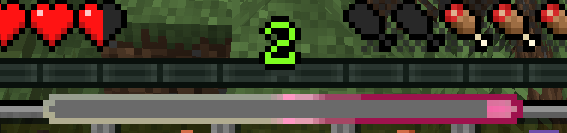

# Form Types

The forms you can transform into in the mod are categorized into `Progressive Forms`, `Special Forms`, `Permanent Forms`, and `Sub-Forms`.

# Progressive Forms

`Progressive Forms` feature multiple gradually changing stages. Starting from version 1.10.0, stages are named `Phase Initial`, `Phase 1`, `Phase 2`, and `Phase Permanent`.

For these forms, as your `Instinct Value` accumulates, your form will advance to the next stage.

Compared to earlier stages, later stages have more pronounced advantages and disadvantages, creating more significant changes to the gameplay experience.

Your form will be affected by the `Cursed Moon Event` when in a `Progressive Form`.

Most forms in the mod belong to this category.

### Instinct System

The `Instinct System` progress bar appears in the center of the screen, just below the experience bar. It indicates your current `Instinct Value`.

`Instinct Value` increases slowly over time. Additionally, each form has corresponding `Instinct Behaviors`; performing these behaviors also causes `Instinct Value` to increase rapidly.

When `Instinct Value` reaches maximum, your form will advance to the next stage.

In `Phase 2`, the instinct bar becomes locked (use an `Echo Catalyst` to advance to Permanent Phase). In `Phase Permanent` or `Special Forms`, the instinct bar is automatically hidden.

### Progressive Forms List

- Ocelot Form (Phase Initial / Phase 1 / Phase 2)

- Axolotl Form (Phase Initial / Phase 1 / Phase 2)

- Bat Form (Phase Initial / Phase 1 / Phase 2)

- Familiar Fox Form (Phase Initial / Phase 1 / Phase 2)

- Snow Fox Form (Phase Initial / Phase 1 / Phase 2)

- Jackal Form (Phase Initial / Phase 1 / Phase 2)

- Spider Form (Phase Initial / Phase 1 / Phase 2)

# Special Forms

`Special Forms` have no progressive stages. They are also not affected by the `Cursed Moon Event`.

While in a `Special Form`, you can use an `Inhibitor` at any time to revert to your initial form.

### Special Forms List

- Allay Form

- Feral Cat Form

# Permanent Forms

`Permanent Forms` are the final stage (`Phase Permanent`) of `Progressive Forms`.

For a `Progressive Form` that has a corresponding `Permanent Form`, use an `Echo Catalyst` during `Phase 2` to transform into the corresponding permanent form.

Once in a permanent form, you can use a `Form Tuner Beacon` to unlock its dedicated `Perk Tree`. See `Form Attuning & Perk Trees` for details.

**Important Warning: Once transformed into a Permanent Form, there are no in-game mechanics to revert this change. Proceed with caution!**

!!! note

    Q: I regret my decision! Are there really no other solutions?

    A: Yes, there are options! With administrator permissions, you can use `/shape_shifter_curse transform_to_form` to set your form, or use a `Creative Inhibitor` in Creative mode to revert.

### Permanent Forms List

- Ocelot Form (Phase Permanent)

- Axolotl Form (Phase Permanent)

- Bat Form (Phase Permanent)

- Familiar Fox Form (Phase Permanent)

- Snow Fox Form (Phase Permanent)

- Jackal Form (Phase Permanent)

- Spider Form (Phase Permanent)

# Sub-Forms

Certain forms can switch to a corresponding `Sub-Form` via a `Ripple Mirror` after reaching `Phase Permanent`, and can switch back to their main form at any time.

See the `Sub-Forms` section for details.
