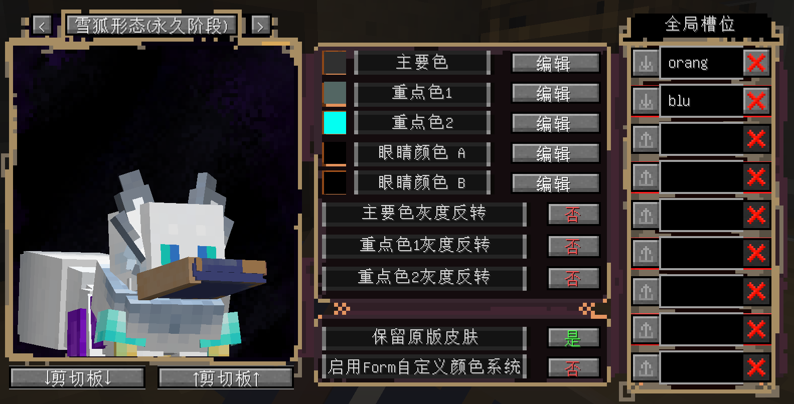
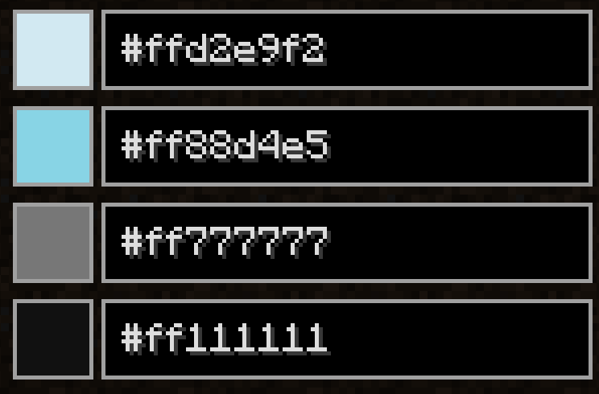

# Mod Configuration Options

It is strongly recommended to install [Mod Menu](https://www.curseforge.com/minecraft/mc-mods/modmenu) to configure the mod in-game.

### Player Custom Configuration

Config file path: `config/shape-shifter-curse-client-custom.toml`

Starting from version 1.9.2, it is recommended to open the **visual interactive Form Color Menu** from the `Book of Shape Shifter` or Mod Menu to adjust colors with live previews instead of converting Hex values manually.

If editing the config file manually, common options include:

- `keep_original_skin = true`

        Whether to keep your original player skin.

- `enable_form_color = true`

        Whether to enable custom form colors.

- `primaryColor = 13822450`

        Primary form color (decimal value converted from Hex).

- `accentColor1Color = 8967397`

        Accent color 1 of the form.

- `accentColor2Color = 7829367`

        Accent color 2 of the form.

- `eyeColor = 1118481`

        Eye color of the form. Only applies to forms whose eyes support color override.

- `primaryGreyReverse = false` / `accent1GreyReverse = false` / `accent2GreyReverse = false`

        Whether to invert the grayscale texture blending for each color channel.

Since version 1.0.73, the alpha channel (first two Hex digits) controls whether the original texture color is overridden, accepting only `FF` or `00`. Setting it to `00` preserves the original texture color for that region (useful for customizing only eye color, etc.).

### Client Configuration

Config file path: `config/shape-shifter-curse-client.toml`

- `enableFormModelOnVanillaFirstPersonRender = true`

        Determines whether form arm models render in vanilla first-person view. Set to `false` if you experience first-person performance drops.

- `newStartBookForBiggerScreen = false`

        Enables a scaled-up Book of Shape Shifter interface, useful on high-resolution screens.

- `minBlinkIntervalTick = 60` / `maxBlinkIntervalTick = 140` / `blinkTick = 4`

        Controls the minimum interval, maximum interval, and duration (in ticks) of form eye-blinking animations.

- `fcs_use_v1_menu = false`

        Switches to the professional Form Color Menu (V1) instead of the streamlined standard menu (V2).

- `disableUnlockCheckInFormColorSelectMenu = false`

        Disables form unlock checks in the color menu (set to `true` to preview and customize colors for forms you have not unlocked yet).

- `enableChangeFPMConfig = true` / `enableBetterCombatFix = true`

        Controls automatic First-person Model offset resetting and Better Combat compatibility fixes.

- HUD Position Offset Options

        Under the `UI` category, you can customize the anchor type (1–9) and X/Y offsets for the `Instinct Bar`, `Mana Bar`, and other HUD elements.

### Server / Common Configuration

Config file path: `config/shape-shifter-curse-common.toml`

- `transformativeBatSpawnChance = 0.5` / `transformativeAxolotlSpawnChance = 0.5` / `transformativeOcelotSpawnChance = 0.5` / `transformativeWolfSpawnChance = 0.5` / `transformativeSpiderSpawnChance = 0.5`

        Controls the spawn chance for Cursed Bats, Axolotls, Ocelots, Wolves, and Spiders (set to `0` to disable spawning).

- `curseMoonPhase = [1, 5]`

        Lunar phases (0–7) on which Cursed Moon events trigger (clear the array to disable Cursed Moon events; requires a game or server restart).

- `allowSleepInCursedMoon = false`

        Whether players can sleep during a Cursed Moon event. If `true`, waking up reverts your form to its pre-Cursed Moon state.

- `enableCursedMoonTransform = true`

        Whether the Cursed Moon forces form transformations. When `false`, the event and moondust drops remain active without altering player forms.

- `enableInitialForm = false`

        Enables server-side custom starting forms (requires gamerule `sscUseInitialForm` to also be `true`).

- `initialFormIds = ["shape-shifter-curse:original_before_enable:1"]`

        Candidate starting forms in `namespace:form_id:weight` format (supports datapack forms), randomly chosen by weight for new players. See `Enable Mod Content` for details.

- `immediatelyTransform = false`

        Skips transformation transition animations for instant transformations.

- `statusPotionWithCurse = false` / `witchPotionForPreBook = false`

        Controls whether transformative potions affect players who have not opened the Book of Shape Shifter yet, and whether witches throw form potions at pre-book players.

- `enableFoodHabitSystem = true`

        Enables or disables form dietary restrictions.

- `enableFullStackUpgrade = true`

        Allows Smithing Table morphscale upgrades to process full stacks (disable if it conflicts with another mod).
