# Mod Added Items

This section lists the items added by this mod and their crafting recipes.

## Basic Items

### Untreated Moondust

`Untreated Moondust` is the core item of the mod. It involves most of the mod's content.

`Untreated Moondust` drops from mobs during `Cursed Moon` events.

After version 1.8.1, to accommodate gameplay without the `Cursed Moon Event` enabled, a crafting recipe for `Untreated Moondust` was added.

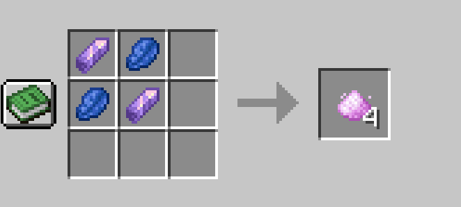

### Moondust Crystal Grit

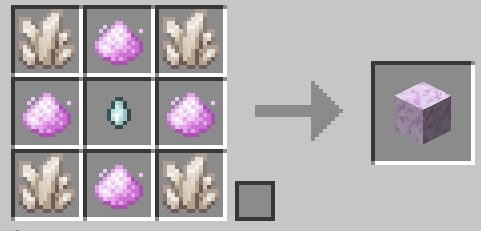

`Moondust Crystal Grit` is a craftable placeable block item. `Moondust Crystal` needs to be smelted from `Moondust Crystal Grit`.

See the `Form-Specific Tools and Trinkets` section for details.

### Moondust Crystal

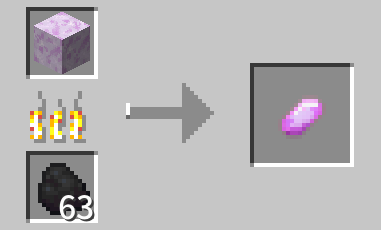

`Moondust Crystal` is an advanced material for crafting form-specific tools, trinkets, and altar recipes. It can be obtained by smelting `Moondust Crystal Grit` or crafting it directly at the `Shape Shifter Altar`.

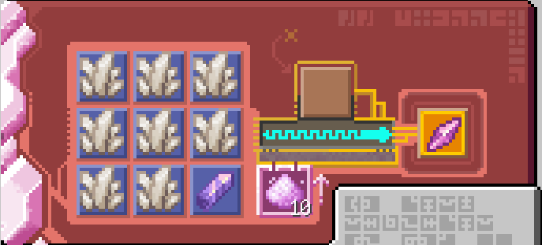

See the `Form Specific Tools And Trinkets` and `Shape Shifter Altar & Catalyst Cores` sections for details.

### Glint Prism

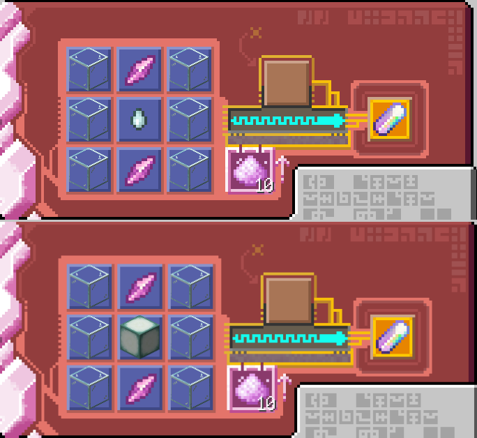

Crafted at the `Shape Shifter Altar` (using either a Sea Lantern or a Ghast Tear in the center). `Glint Prisms` are used to craft `Catalyst Cores` and unlock high-tier `Perk Tree` nodes.

## Form-Affecting Items

### Moondust Matrix

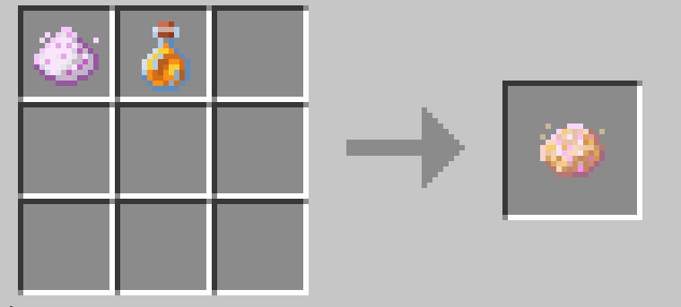

The `Moondust Matrix` is the core ingredient for brewing `Form Potions` and crafting other related items.

### Catalyst

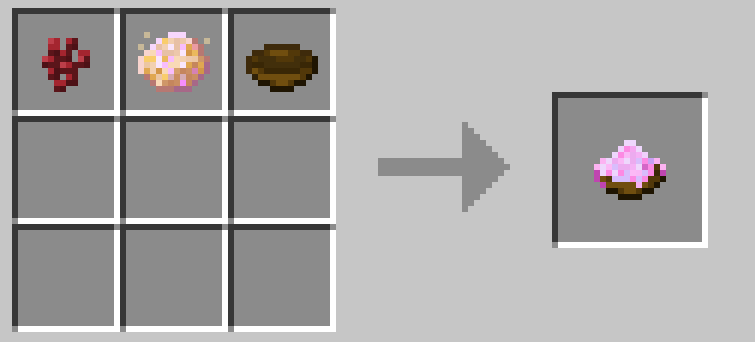

Significantly increases your current `Instinct Value`.

### Inhibitor

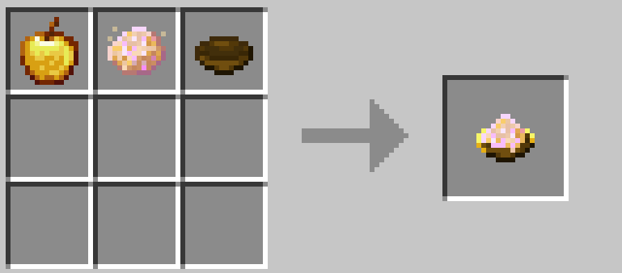

When in `Phase Initial` or `Phase 1` of a `Progressive Form`, or when in a `Special Form`, using this reverts your form by one stage. It also cures `Transformation Status Effects`.

### Golden Apple

Significantly decreases your current `Instinct Value` and cures `Transformation Status Effects`.

Starting from version 1.10.0, eating a `Golden Apple` while in `Phase Initial` reverts you directly back to your pre-transformation form.

### Echo Catalyst

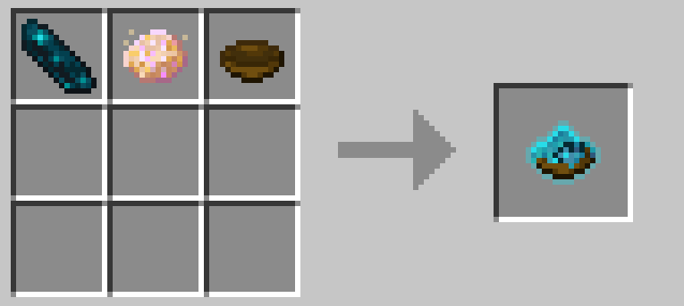

For `Progressive Forms` that include a `Permanent Phase`: use this during `Phase 2` to transform into the corresponding permanent form.

### Powerful Inhibitor

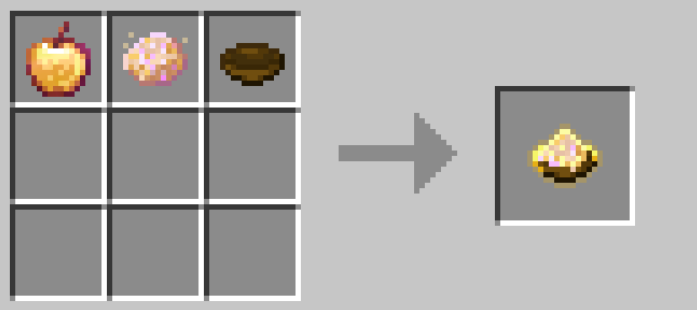

Similar to the Inhibitor, but effective on `Phase 2` of `Progressive Forms`, reverting non-permanent forms directly back to their initial stage.

### Creative Inhibitor

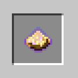

An item that can revert all forms, including permanent forms, back to the initial form. It cannot be crafted and can only be obtained in creative mode.

However, you can make it craftable by adding a custom recipe yourself.

### Ripple Mirror

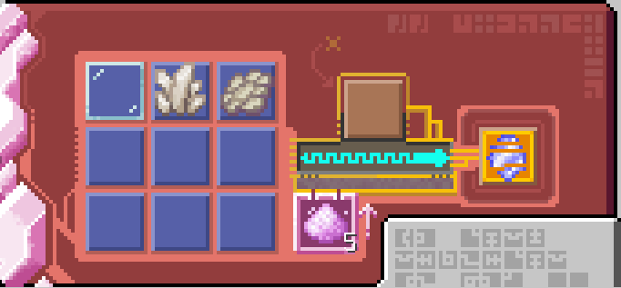

Crafted at the `Shape Shifter Altar`. While in a permanent form that has sub-forms, hold right-click to open `The Mirror` interface and switch between the main form and its sub-forms. See the `Sub-Forms` section for details.

## Other Items

### Fire Charm Paper & Explosive Charm Paper

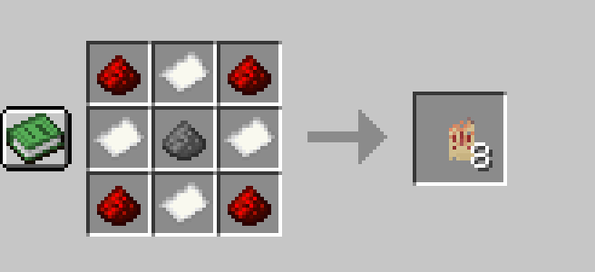

`Fire Charm Paper` is a consumable item used by `Familiar Fox Form` to launch enhanced fireballs.

Starting from version 1.10.0, you can upgrade it at the `Shape Shifter Altar` with a `Foxfire Catalyst Core` into the stronger `Explosive Charm Paper`.

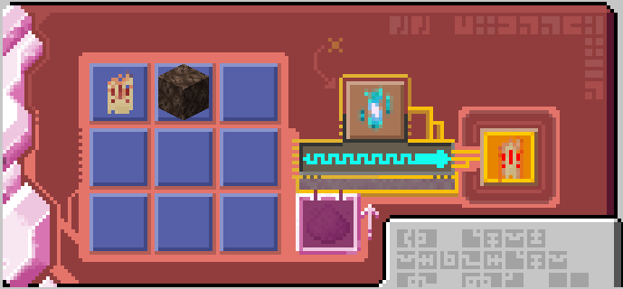

### Potion Charms

After unlocking the corresponding Perk Tree node, `Familiar Fox Form` can craft `Healing`, `Harming`, and `Poison Potion Charms` directly in the inventory using mana to fire potion-infused charm arrows.

## Shape Shifter Altar, Catalyst Cores & Form Tuner Beacon

See the `Shape Shifter Altar & Catalyst Cores` and `Form Attuning & Perk Trees` sections for details.

## Form-Specific Tools and Trinkets

See the `Form Specific Tools And Trinkets` section for details.

## Morphscale Armors

See the `Morphscale Armors` section for details.