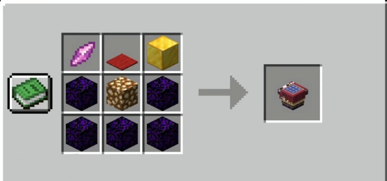
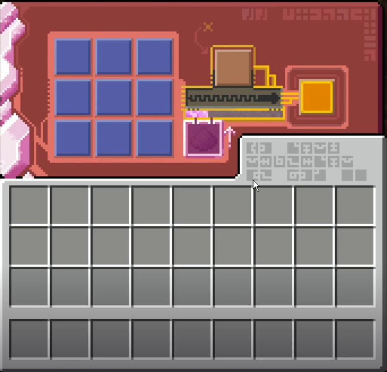
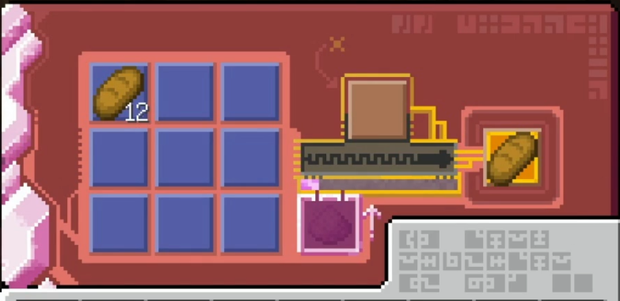

# Shape Shifter Altar & Catalyst Cores

Starting from version 1.10.0, the mod introduces the `Shape Shifter Altar` block and a set of `Catalyst Cores`, forming the core mid-to-late-game crafting and upgrade progression.

## Shape Shifter Altar

The `Shape Shifter Altar` is a transmutation workstation powered by moondust magic. Form trinkets, `+` upgraded trinkets, Catalyst Cores, key progression materials, and `Morphscaled Food` are crafted here.

Right-clicking the altar opens its crafting interface with four areas:

- **3×3 Input Grid**: Place crafting ingredients here.
- **Catalyst Slot**: Place the required `Catalyst Core` for upgrade recipes (**Catalyst Cores are not consumed during crafting**).
- **Fuel Slot**: Insert `Untreated Moondust` to power the altar.
- **Output Slot**: Collect the completed item.

## Catalyst Cores

`Catalyst Cores` are advanced catalysts used to upgrade form trinkets, charm papers, and morphscale equipment. They are crafted at the `Shape Shifter Altar` around a `Glint Prism` (or `Moondust Crystal` for the `Morphscale Catalyst Core`).

Once crafted, place a Catalyst Core in the altar's catalyst slot—it can be reused indefinitely without being consumed.

| Catalyst Core | Primary Uses |
| :---: | --- |
| Jungle Catalyst Core | Upgrades Ocelot trinkets (`Collar of Whiskers+`, `Digestion Fiber Ball+`) |
| Web Catalyst Core | Upgrades Spider trinket (`Venom Spindle+`) |
| Frost Catalyst Core | Upgrades Snow Fox trinkets & tool (`Bottled Snowfall+`, `Charm of Reverse Thermometer+`, `Frost Pawglove+`) |
| Foxfire Catalyst Core | Upgrades Familiar Fox trinket & charm (`Amulet Bracelet+`, `Explosive Charm Paper`) |
| Surge Catalyst Core | Upgrades Axolotl trinket (`Fountain Belt+`) |
| Dune Catalyst Core | Upgrades Anubis Wolf trinket (`Withered Bandage+`) |
| Night Catalyst Core | Upgrades Bat trinkets (`Attach Hook+`, `Charm of Hollow Fang+`, `Charm of Night Crystal+`) |
| Morphscale Catalyst Core | Grants the morphscale property to any armor or tool at the altar |

## Morphscaled Food

Place **a single food item alone** into the altar's 3×3 grid (leaving all other input slots and the catalyst slot empty) to transmute it into `Morphscaled Food` using a small amount of moondust fuel.

Food with the `Morphscaled Food` tag ignores form dietary restrictions and can be eaten normally by any form.

## Other Key Outputs

In addition to base form trinkets and `+` upgrades, the `Shape Shifter Altar` is used to craft:

- `Glint Prism`: Core ingredient for Catalyst Cores and currency for high-tier Perk Tree nodes.
- `Ripple Mirror`: Used in Permanent Phase to switch to or from a `Sub-Form`.
- `Form Tuner Beacon`: Used to unlock Form Perk Trees.
- `Moondust Crystal`: Alternative altar crafting route alongside smelting `Moondust Crystal Grit`.
- `Morphscale Equipment Upgrade`: Pair with the `Morphscale Catalyst Core` to grant morphscale properties to any equipment. See the `Morphscale Armors` section for details.
