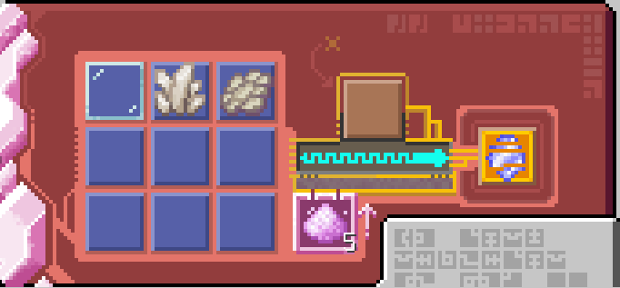
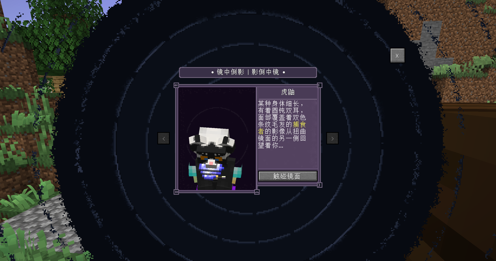

# Sub-Forms

Starting from version 1.10.0, certain forms can switch to a corresponding `Sub-Form` after reaching their `Permanent Phase`.

`Sub-Forms` feature independent models, animations, strengths, drawbacks, and their own dedicated Perk Trees, offering a distinct playstyle from their main form.

## How to Switch Sub-Forms

To switch to a sub-form, you must be in the `Permanent Phase` of its corresponding main form and craft a `Ripple Mirror` at the `Shape Shifter Altar`.

Hold right-click with the `Ripple Mirror` to open the `The Mirror` interface, where you can preview and choose your target form.

Confirming a transformation consumes one `Ripple Mirror` (simply opening the menu to preview does not consume it).

## Sub-Form Characteristics

- **Switch Back Anytime**: Use a `Ripple Mirror` again while in a sub-form to switch back to the original main form (you cannot switch across different form groups).

- **Shared Main Form Trinkets**: Sub-forms share their base form layer with the main form, so you can continue using the main form's exclusive trinkets directly.

- **Independent Perk Tree**: Each sub-form has its own Perk Tree that can be unlocked via the `Form Tuner Beacon`.

---

## Current Sub-Form List

### Bat Form (Permanent Phase)

- **Avali**: An alien raptor from another plane of existence🍐. What could have brought them here?

### Snow Fox Form (Permanent Phase)

- **Marbled Polecat**: A nimble hunter with a long, slender body and a remarkably flexible neck.
